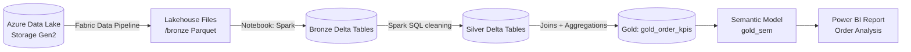
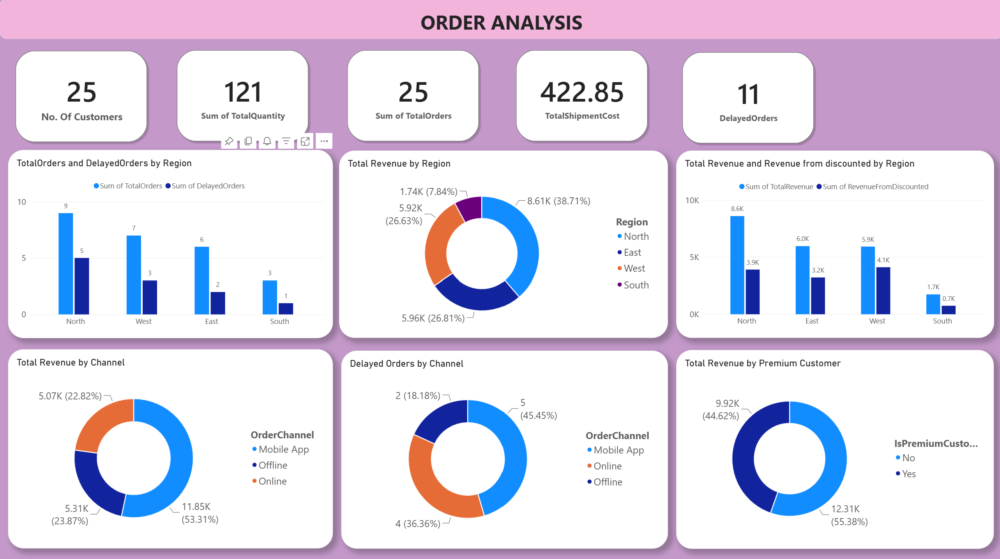
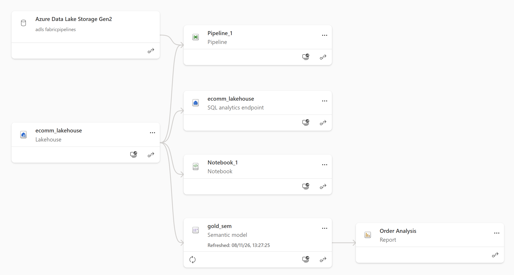

# 📦 SmartDelivery360 – Online Orders & Delivery Delay Analysis

**An end-to-end data engineering project on Microsoft Fabric** using a Medallion Architecture (Bronze → Silver → Gold), Spark SQL, Data Pipelines, Delta tables and Power BI.


---

## 📑 Table of Contents
1. [Business Problem](#-business-problem)
2. [Solution Overview](#-solution-overview)
3. [Architecture](#-architecture)
4. [Tech Stack](#-tech-stack)
5. [Data Model](#-data-model)
6. [Implementation Walkthrough](#-implementation-walkthrough)
7. [Dashboard & Insights](#-dashboard--insights)
8. [Lineage](#-lineage)
9. [Future Improvements](#-future-improvements)

---

## 🧠 Business Problem

**SmartDelivery360** is an eCommerce platform that tracks online orders, delivery times and product logistics. Leadership had order data spread across multiple raw files and no single view to answer questions such as:

- Which orders are being **delivered late**, and where?
- How much does **shipping cost** impact the business?
- How do **channels** (Mobile App / Online / Offline) and **regions** compare?
- Which **product categories** are trending?
- How do **premium customers** behave versus regular customers?

## 💡 Solution Overview

I built a complete analytics pipeline in **Microsoft Fabric** that:

1. **Ingests** raw order data from **Azure Data Lake Storage Gen2** using a **Fabric Data Pipeline**.
2. **Stores** it in a **Lakehouse** as Bronze Delta tables.
3. **Cleans and standardises** it into Silver tables using **Spark SQL**.
4. **Joins and aggregates** it into a business-ready Gold KPI table.
5. **Serves** it through a **Semantic Model** to an interactive **Power BI report**.

---

## 🏗 Architecture



| Layer | Purpose | Objects |
|-------|---------|---------|
| **Source** | Raw files landed in cloud storage | ADLS Gen2 account |
| **Bronze** | Raw data as-is, stored as Delta | `bronze_orders`, `bronze_customers`, `bronze_products`, `bronze_order_items` |
| **Silver** | Cleaned, typed, standardised | `silver_orders`, `silver_customers`, `silver_products`, `silver_order_items` |
| **Gold** | Aggregated, business-ready KPIs | `gold_order_kpis` |
| **Serving** | Semantic model + report | `gold_sem`, *Order Analysis* |

---

## 🛠 Tech Stack

| Component | Usage |
|-----------|-------|
| **Microsoft Fabric** | Unified analytics platform |
| **Azure Data Lake Storage Gen2** | Source data storage |
| **Fabric Data Pipeline** | Orchestrating ingestion into the Lakehouse |
| **Lakehouse + SQL analytics endpoint** | Storage and SQL access layer |
| **Fabric Notebook (PySpark + Spark SQL)** | Transformations for every layer |
| **Delta Lake** | Table format for Bronze, Silver and Gold |
| **Power BI (Semantic Model + Report)** | Dashboarding and insights |

---

## 🗂 Data Model

**Source entities (4 tables)**

| Table | Key Columns |
|-------|-------------|
| `orders` | OrderID, CustomerID, OrderDate, ShippedDate, DeliveredDate, Price, OrderChannel, Region, ReferredBy |
| `customers` | CustomerID, CustomerName, IsPremiumCustomer, SignupDate |
| `products` | ProductID, Category, Carrier, ShipmentCost, IsDiscounted |
| `order_items` | OrderID, ProductID, Quantity |

**Relationships**

```
customers 1 ──── * orders 1 ──── * order_items * ──── 1 products
```

---

## 🚀 Implementation Walkthrough

### 1️⃣ Ingestion – Data Pipeline (`Pipeline_1`)
A Fabric Data Pipeline connects to the ADLS Gen2 account and lands the source files in the Lakehouse under `Files/bronze/` as Parquet.

### 2️⃣ Bronze Layer – Raw Delta Tables
The notebook reads each Parquet file with Spark and persists it as a Delta table with no business changes, which preserves the raw data for traceability.

```python
orders_raw = spark.read.parquet("abfss://<workspace>@onelake.dfs.fabric.microsoft.com/<lakehouse>/Files/bronze/orders.parquet")

orders_raw.write.format("delta").mode("overwrite").saveAsTable("bronze_orders")
# same pattern for customers, products, order_items
```

### 3️⃣ Silver Layer – Cleaning with Spark SQL
Each table is cleaned for type safety, consistent formatting and data quality.

| Table | Transformations |
|-------|-----------------|
| `silver_orders` | Cast IDs to `STRING`; normalise dates (`/` → `-`) with `TO_DATE`; round `Price` to 2 decimals; `TRIM` + `INITCAP` on `OrderChannel` and `Region`; drop rows with `NULL` OrderID |
| `silver_customers` | Cast IDs; `INITCAP(TRIM())` on names; standardise `IsPremiumCustomer` (`yes`/`y` → `Yes`, else `No`); cast `SignupDate`; drop `NULL` CustomerID |
| `silver_products` | Cast IDs; clean `Category` and `Carrier`; round `ShipmentCost`; standardise `IsDiscounted` to `Yes`/`No`; drop `NULL` ProductID |
| `silver_order_items` | Cast IDs and `Quantity` to `INT`; keep only rows with `Quantity > 0` |

```sql
CREATE OR REPLACE TABLE silver_orders AS
SELECT
  CAST(OrderID AS STRING)                       AS OrderID,
  CAST(CustomerID AS STRING)                    AS CustomerID,
  TO_DATE(REPLACE(OrderDate, '/', '-'))         AS OrderDate,
  TO_DATE(REPLACE(ShippedDate, '/', '-'))       AS ShippedDate,
  TO_DATE(REPLACE(DeliveredDate, '/', '-'))     AS DeliveredDate,
  ROUND(CAST(Price AS DOUBLE), 2)               AS Price,
  INITCAP(TRIM(OrderChannel))                   AS OrderChannel,
  INITCAP(TRIM(Region))                         AS Region,
  TRIM(ReferredBy)                              AS ReferredBy
FROM bronze_orders
WHERE OrderID IS NOT NULL;
```

### 4️⃣ Gold Layer – Business KPIs

**Step A – Enriched view.** All four Silver tables are joined and a derived **`DeliveryDelay`** metric is calculated:

```sql
CREATE OR REPLACE TEMP VIEW orders_enriched AS
SELECT
    o.*, c.CustomerName, c.IsPremiumCustomer, c.SignupDate,
    i.ProductID, i.Quantity,
    p.Category, p.Carrier, p.ShipmentCost, p.IsDiscounted,
    DATEDIFF(o.DeliveredDate, o.ShippedDate) AS DeliveryDelay
FROM silver_orders o
LEFT JOIN silver_customers   c ON o.CustomerID = c.CustomerID
LEFT JOIN silver_order_items i ON o.OrderID    = i.OrderID
LEFT JOIN silver_products    p ON i.ProductID  = p.ProductID;
```

**Step B – Aggregated KPI table** (`gold_order_kpis`), grouped by customer, premium status, region and channel:

| KPI | Definition |
|-----|------------|
| `TotalOrders` | Distinct orders |
| `TotalQuantity` | Sum of items ordered |
| `TotalRevenue` | Sum of order price |
| `AvgDeliveryDelayDays` | Average of (Delivered − Shipped) in days |
| `DelayedOrders` | Distinct orders where delivery took **more than 3 days** |
| `TotalShipmentCost` | Sum of shipment cost |
| `RevenueFromDiscounted` | Revenue from discounted products |
| `MaxDeliveryDelay` | Longest delivery delay |

### 5️⃣ Semantic Model & Power BI
The Gold table is exposed through the **`gold_sem`** semantic model and visualised in the **Order Analysis** report.

---

## 📊 Dashboard & Insights



### Key Findings

**🌍 By Region**
- **North** is the strongest region with **8.61K revenue (38.71%)** and **9 orders**, but it also has the most delays (**5 of 9**).
- **East** (5.96K) and **West** (5.92K) are almost equal in revenue; **South** is the smallest at **1.74K (7.84%)**.
- **Revenue from discounted products** is highest in **West (4.1K)** and **North (3.9K)**, which shows discounts drive a large share of sales.

**📱 By Channel**
- **Mobile App** generates the most revenue (**11.85K, 53.31%**), but it also accounts for the most delayed orders (**5 of 11, 45.45%**).
- **Online** has **4 delayed orders (36.36%)** on only 22.82% of revenue, so its fulfilment performance is worth investigating.
- **Offline** is the most reliable channel with just **2 delayed orders (18.18%)**.

**⭐ Premium Customers**
- Premium customers contribute **9.92K (44.62%)** of revenue and non-premium customers **12.31K (55.38%)**, so premium revenue is substantial for a segment that is usually much smaller.

**🚚 Delivery Performance**
- **11 of 25 orders (44%)** were delayed, which is a significant service-quality gap.

### Business Recommendations
1. Review **carrier performance** in the North region and on the Mobile App channel to reduce delays.
2. Investigate fulfilment on the **Online** channel, where delays are disproportionate to revenue.
3. Prioritise delivery SLAs for **premium customers** to protect high-value relationships.
4. Analyse whether **discount-driven orders** are creating shipping pressure.

---

## 🔗 Lineage



---

## 🔮 Future Improvements

- Add **incremental loads** and pipeline scheduling instead of full overwrites.
- Add **data quality checks** (null counts, duplicate checks, row-count reconciliation).
- Build a **star schema** (fact and dimension tables) in the Gold layer for flexible modelling.
- Add **product category trends** and time-series analysis to the report.
- Add **alerts** (Data Activator) for spikes in delayed orders.
- Set up **Git integration and CI/CD** with Fabric deployment pipelines.

---
